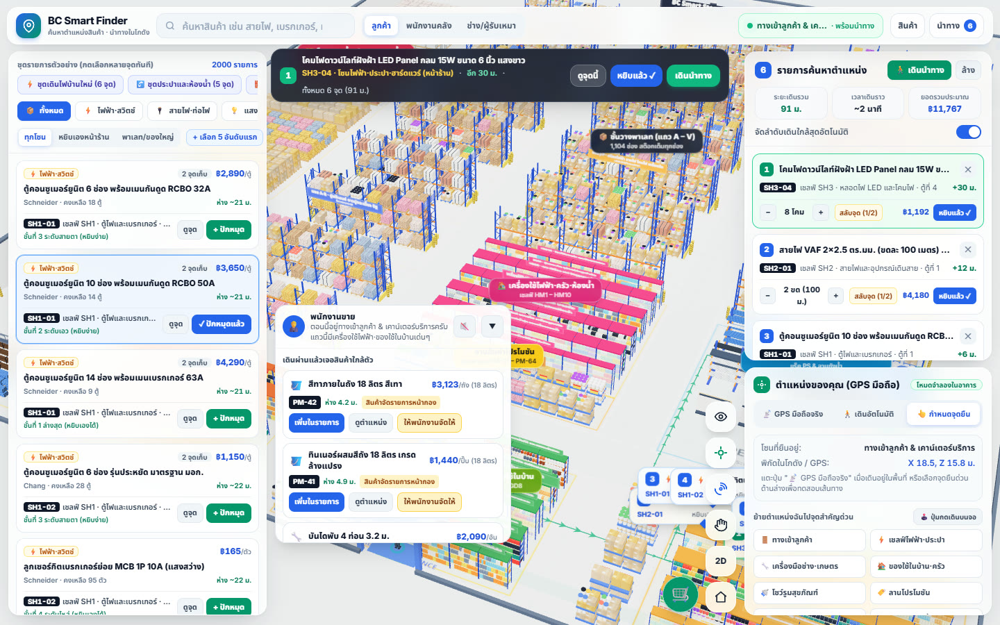
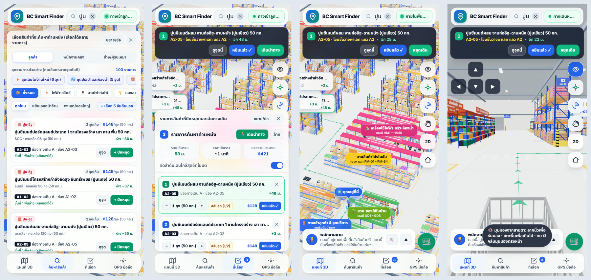
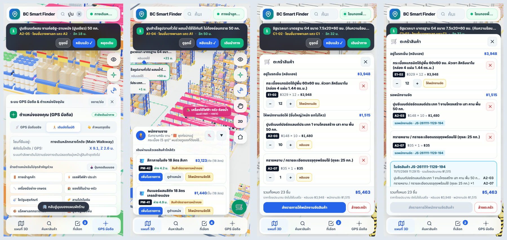
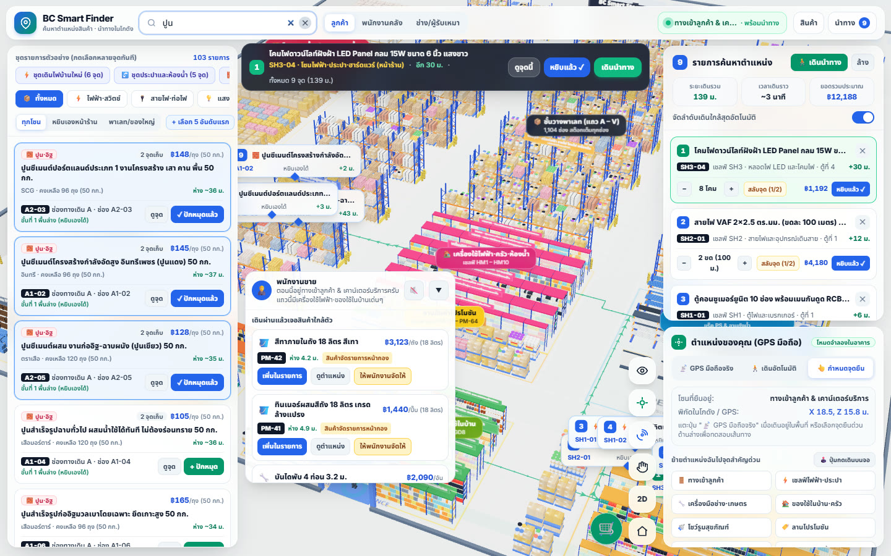
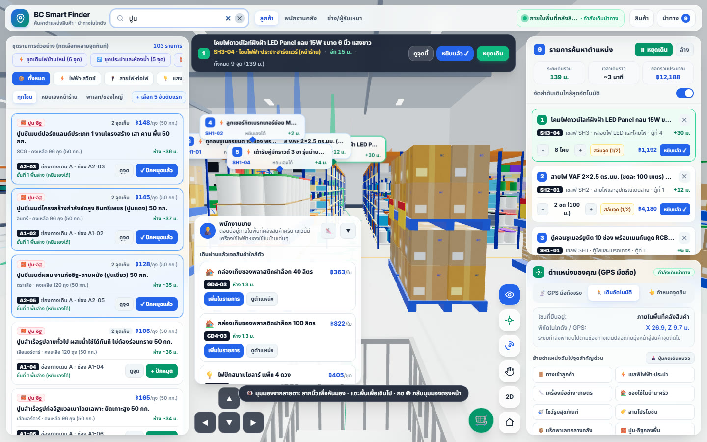

# BC Smart Finder 3D — ระบบค้นหาตำแหน่งสินค้า นำทาง และพนักงานขายในร้านวัสดุก่อสร้าง 3 มิติ (พร้อม GPS มือถือ)

**ลองใช้งาน:** <https://smartfinder.bcsmethai.com> — เปิดจากมือถือ แท็บเล็ต หรือโน้ตบุ๊กได้เลย ไม่ต้องติดตั้งแอป



> ระบบนี้เป็น **ระบบต้นแบบ** ใช้ผังร้านและสินค้าตัวอย่าง 2,000 รายการ ยังไม่ได้เชื่อมฐานข้อมูลของร้านจริง (ดูหัวข้อ [Limitation](#limitation))

## Objective

ระบบค้นหาตำแหน่งสินค้าและนำทางเดินภายในร้านค้า-คลังวัสดุก่อสร้าง ไฟฟ้า ประปา เหล็ก สี กระเบื้อง เครื่องมือช่าง เกษตร-สวน และของใช้ในบ้าน ในรูปแบบแผนผัง 3 มิติ ออกแบบสำหรับ **ลูกค้า, พนักงานคลังสินค้า, และช่าง/ผู้รับเหมา** เพื่อ

- ค้นหาสินค้า 2,000 รายการ ปักหมุดหลายรายการพร้อมกัน และคำนวณลำดับเส้นทางเดินหยิบสินค้าที่สั้นที่สุด
- ระบุตำแหน่งผู้ใช้งานด้วย **GPS มือถือ** และเดินดูร้านด้วย **มุมมองจากสายตาลูกค้า** (เหมือนถือมือถือเดินหาสินค้า พร้อมรถเข็น)
- ให้ระบบทำหน้าที่ **พนักงานขาย**: แนะนำสินค้าใกล้ตัวระหว่างเดิน บอกของที่ต้องใช้คู่กัน และรับรายการสินค้าชิ้นใหญ่ไว้ใน **ตะกร้า** เพื่อให้พนักงานจัดสินค้าให้ภายหลัง

รองรับสมาร์ตโฟน แท็บเล็ต และโน้ตบุ๊ก

สิ่งที่ลูกค้าได้

- หาของเจอเอง ไม่ต้องรอถามพนักงาน
- เดินตามเส้นทางที่ระบบจัดให้ ไม่ต้องเดินวน
- มีการเตือนของที่ยังขาดในชุดงาน ไม่ต้องกลับมาซื้อรอบสอง
- ของชิ้นใหญ่ไม่ต้องยกเอง ส่งรายการให้พนักงานจัดให้

สิ่งที่เจ้าของร้านได้

- พนักงานไม่ต้องทิ้งงานมาเดินพาลูกค้าหาของ
- สินค้าจัดรายการและของที่ใช้คู่กันถูกแนะนำให้ลูกค้าเห็นระหว่างเดิน
- ลูกค้าเห็นยอดรวมโดยประมาณจากตะกร้าก่อนถึงแคชเชียร์
- ใช้ผ่านเว็บ ไม่ต้องทำแอป ไม่ต้องให้ลูกค้าติดตั้งอะไร

## ภาพหน้าจอ

ภาพทั้งหมดถ่ายจากระบบจริงที่ <https://smartfinder.bcsmethai.com>

### ค้นหา ปักหมุด และเดินตามเส้นทาง (มือถือ)



จากซ้ายไปขวา

1. **ค้นหาสินค้า** — พิมพ์ `ปูน` ได้ 103 รายการ แต่ละรายการบอกราคา จำนวนคงเหลือ รหัสช่องเก็บ และระยะห่างจากจุดที่ยืน
2. **รายการที่ปักหมุด** — ระบบจัดลำดับเดินให้ บอกระยะทาง เวลาเดิน และยอดรวมโดยประมาณ
3. **เส้นทางบนผังร้าน** — แถบด้านบนบอกจุดถัดไปและระยะที่เหลือ มีปุ่ม `ดูจุดนี้`, `หยิบแล้ว`, `เดินนำทาง`
4. **มุมมองจากสายตา** — เห็นทางเดินและชั้นวางเหมือนเดินอยู่ในร้าน มีปุ่มลูกศรเดินและหันบนจอ

### ตำแหน่งของเรา พนักงานขาย ตะกร้า และใบจัดสินค้า (มือถือ)



จากซ้ายไปขวา

1. **ตำแหน่งของคุณ** — เลือก `GPS มือถือจริง`, `เดินอัตโนมัติ` หรือ `กำหนดจุดยืน` และมีปุ่มลัดย้ายไปยืนตามโซน
2. **พนักงานขาย** — แนะนำสินค้าที่อยู่ใกล้ตัวพร้อมระยะห่าง และสินค้าจัดรายการหน้ากอง
3. **ตะกร้าสินค้า** — แยก *อยู่ในรถเข็น (หยิบเอง)* กับ *ให้พนักงานจัดให้* พร้อมยอดรวมโดยประมาณ
4. **ใบจัดสินค้า** — กดส่งรายการแล้วได้เลขที่ `JS-…` ไว้แจ้งที่จุดบริการลูกค้า

### หน้าจอโน้ตบุ๊ก



ค้นหา `ปูน` แล้วกด `+ ปักหมุด` — รายการสินค้าอยู่ซ้าย ผังร้าน 3 มิติอยู่กลาง รายการที่ปักหมุดและแผงตำแหน่งอยู่ขวา



มุมมองจากสายตาลูกค้า (ปุ่ม 👁) ระหว่างเดินนำทาง

## Workflow

1. **เริ่มต้นที่ทางเข้าลูกค้า**: ระบบโหลดผังร้าน 3 มิติที่สต็อกเต็มทุกโซน — ชั้นวางพาเลท 1,104 ช่อง (แถว A–V), เชลฟ์หยิบเอง SH1–SH8 / GD1–GD8 / TG1–TG8 / HM1–HM10, โชว์รูมสุขภัณฑ์-กระเบื้อง TS1–TS6, ลานสินค้าโปรโมชัน PM-01–PM-64, ลานท่อและเหล็กรูปพรรณ, กองพื้นปูน-อิฐ และโซนของยาว — ในฉากมีเฉพาะตัวลูกค้ากับรถเข็นที่ประตูทางเข้า (`X 18.5, Z 15.8`)
2. **ค้นหาและกรองสินค้า**: พิมพ์ชื่อสินค้า ยี่ห้อ คำเรียกช่าง หรือรหัสช่องเก็บ หรือกรองตามหมวดหมู่ 12 หมวด และกรองโซนหยิบเองหน้าร้าน / โซนพาเลทของใหญ่ สินค้าที่ชื่อตรงกับคำค้นขึ้นก่อนสินค้าที่ตรงแค่คำเรียกอื่น รายการแสดงทีละ 60 รายการ กด **`แสดงเพิ่ม`** เพื่อดูต่อ
3. **ปักหมุดหลายสินค้าพร้อมกัน**: กด **`+ ปักหมุด`** ได้ไม่จำกัด (หรือเลือก **ชุดรายการตัวอย่างด่วน**) ระบบแสดงเสาลำแสง กรอบไฮไลต์ชั้นวาง และป้ายลำดับการเดิน `1, 2, 3...`
4. **คำนวณเส้นทางเดินใกล้สุด**: กราฟทางเดินเท้า (`A* / Dijkstra` + `Nearest-Neighbor` + `2-Opt`) จัดลำดับจุดแวะตามช่องทางเดินจริงโดยไม่ตัดทะลุชั้นวาง พร้อมลูกศรนำทางบนพื้น
5. **นำทาง**:
   - **📡 GPS มือถือจริง**: รับพิกัดต่อเนื่องผ่าน `navigator.geolocation.watchPosition` และเข็มทิศ `DeviceOrientationEvent` พร้อมปุ่มเทียบจุดอ้างอิงที่ประตูทางเข้า
   - **🚶 เดินอัตโนมัติ**: จำลองการเดินตามลูกศรไปทีละจุดจนครบ
   - **👆 กำหนดจุดยืน**: ปุ่มลัดโซน แตะพื้น หรือปุ่มลูกศรเดินบนหน้าจอ
6. **มุมมองจากสายตา (ปุ่ม 👁)**: กล้องอยู่ระดับสายตาลูกค้า เห็นรถเข็นอยู่ข้างหน้า
   - เอียง/หันมือถือ → ภาพหมุนตามทันที (เซ็นเซอร์ `DeviceOrientationEvent`)
   - ลากนิ้วบนจอ → หันมอง · แตะพื้น → เดินไปจุดนั้นตามทางเดิน · ปุ่ม ▲▼ เดินหน้า/ถอย · ◀▶ หันซ้าย/ขวา
   - ปุ่ม **◎** → กลับมามองตรงไปข้างหน้า (ตั้งศูนย์ใหม่)
7. **พนักงานขาย (การ์ดมุมล่าง)**: ทักทายเมื่อเข้าโซนใหม่, แนะนำสินค้าใกล้ตัวและสินค้าจัดรายการหน้ากองโปรโมชัน, บอกของที่ต้องใช้คู่กับสินค้าที่เลือก, ถามงานที่จะทำแล้วเลือกชุดรายการให้ พร้อมเตือนรายการที่ยังขาด และพูดเป็นเสียงภาษาไทยได้ (ปุ่ม 🔊/🔇)
8. **ตะกร้า (ปุ่ม 🛒)**: กด **`หยิบแล้ว`** ที่จุดสินค้า ของจะเข้าตะกร้า แยกเป็น *หยิบเองใส่รถเข็น* กับ *ให้พนักงานจัดให้* (สินค้าชิ้นใหญ่/หนัก/อยู่ชั้นสูง ระบบเลือกให้อัตโนมัติ สลับเองได้) แสดงยอดรวมโดยประมาณ แล้วกด **`ส่งรายการให้พนักงานจัดสินค้า`** เพื่อออกเลขที่ใบจัดสินค้าไว้แจ้งที่จุดบริการ

บนมือถือ หน้าจอแบ่งเป็น 4 แท็บที่แถบล่าง: `แผนที่ 3D`, `ค้นหาสินค้า`, `ที่เลือก`, `GPS มือถือ`

## Config

ปรับได้จากแผง **ตำแหน่งของคุณ (GPS มือถือ)** แถบด้านบน และการ์ดพนักงานขาย:

- **มุมมองผู้ใช้งาน**: `ลูกค้า`, `พนักงานคลัง` (แสดงรหัส SKU และยอดสต็อกรวม), `ช่าง/ผู้รับเหมา`
- **เทียบพิกัดประตูทางเข้า (`📌 ตั้งจุดนี้ = ทางเข้า`)**: ผูกละติจูด/ลองจิจูดปัจจุบันกับประตูทางเข้าลูกค้า `(18.5, 15.8)`
- **ปรับทิศเหนือของอาคาร (`0° – 355°`)**: หมุนแกนพิกัด GPS ให้ตรงกับทิศจริงของอาคาร
- **จัดลำดับเดินใกล้สุดอัตโนมัติ**: เปิด/ปิดการเรียงหมุดตามระยะเดินจริง
- **มุมมอง `2D / 3D / สายตา` และคุณภาพกราฟิก**: `อัตโนมัติ / สูง / กลาง / ประหยัด`
- **เสียงพูดของพนักงานขาย** และการย่อ/ขยายการ์ด: จำค่าไว้ในเครื่อง (`localStorage`)

ไฟล์ในโปรเจกต์ และข้อมูลที่แก้ในโค้ดเมื่อจะปรับให้ตรงกับร้านของแต่ละกิจการ:

| ไฟล์ | หน้าที่ |
| --- | --- |
| [`index.html`](./index.html) | โครงหน้าจอ แถบค้นหา แผงรายการ แถบเมนูมือถือ และสไตล์ |
| [`app.js`](./app.js) | การค้นหา ปักหมุด คำนวณเส้นทาง นำทาง GPS และมุมมองจากสายตา |
| [`warehouse3d.js`](./warehouse3d.js) | ฉากร้าน 3 มิติ: อาคาร ชั้นวาง พาเลท ป้าย และลูกศรนำทาง |
| [`layout.js`](./layout.js) | พิกัดเชลฟ์ โชว์รูม ลานโปรโมชัน และแนวทางเดินของโซนหน้าร้าน (ใช้ชุดเดียวกันทั้งฉาก 3 มิติ ข้อมูลสินค้า และกราฟทางเดิน) |
| [`catalog.js`](./catalog.js) + [`catalog.templates.js`](./catalog.templates.js) | หมวดหมู่ สินค้า ราคา (จำนวนเต็มหน่วยสตางค์) ตำแหน่งจัดเก็บ และการกรองคำค้น |
| [`sales.js`](./sales.js) | พนักงานขาย: กติกาของที่ใช้คู่กัน เกณฑ์สินค้าที่ต้องให้พนักงานจัด ตะกร้า และใบจัดสินค้า |
| [`robots.txt`](./robots.txt), [`sitemap.xml`](./sitemap.xml), [`llms.txt`](./llms.txt) | ข้อมูลสำหรับเครื่องมือค้นหาและ AI Search |

## Dependency

ระบบทำงานแบบ Static ES Modules บนเบราว์เซอร์สมัยใหม่ ไม่ต้องติดตั้งแพ็กเกจ ไม่มีขั้นตอน build และไม่ใช้ API key ใด ๆ:

- **Three.js `0.160.0`** (โหลดผ่าน `<script type="importmap">` จาก CDN) — ฉากร้าน 3 มิติ เสาลำแสง และลูกศรนำทาง
- **Tailwind CSS CDN** + ฟอนต์ **Inter & Noto Sans Thai** — หน้าจอ Responsive
- **Web Browser APIs**: `Geolocation API`, `DeviceOrientationEvent` (เข็มทิศและมุมมองสายตา), `SpeechSynthesis` (เสียงพูดภาษาไทย), `localStorage` (ตะกร้าและค่าที่ตั้งไว้)

## Usage example

รันผ่าน Local HTTP Server ใดก็ได้จากโฟลเดอร์ของโปรเจกต์:

```bash
git clone https://github.com/jaturapornchai/smartfinder01.git
cd smartfinder01
python -m http.server 8080
```

จากนั้นเปิดเบราว์เซอร์:

- **บนโน้ตบุ๊ก**: เข้า `http://localhost:8080` พิมพ์ค้นหา เช่น `สายไฟ 2.5`, `เบรกเกอร์`, `สว่าน`, `ชักโครก`, `ปูน` กด **`+ ปักหมุด`** หลายรายการ แล้วกด **`🚶 เดินนำทาง`** เมื่อถึงจุดกด **`หยิบแล้ว`** แล้วเปิด **🛒** เพื่อดูตะกร้าและส่งรายการให้พนักงานจัดสินค้า
- **บนมือถือ / แท็บเล็ต**: เปิดผ่าน `https://` (หรือ `http://localhost` ขณะพัฒนา) แตะแท็บ **`GPS มือถือ`** กด **`📡 GPS มือถือจริง`** อนุญาตสิทธิ์ตำแหน่ง แล้วกด **`📌 ตั้งจุดนี้ = ทางเข้า`** เมื่อยืนอยู่หน้าประตูร้าน จากนั้นกดปุ่ม **👁** อนุญาตเซ็นเซอร์การเคลื่อนไหว แล้วถือมือถือเดินตามลูกศร
- **ตรวจข้อมูลตอนเปิดหน้า**: Console จะแสดง `[nav] จุดยืนหยิบสินค้าอยู่บนทางเดินเท้าครบ N/N ตำแหน่ง` (ถ้ามีตำแหน่งที่นำทางไม่ถึงจะขึ้นเป็น Error พร้อมรหัสสินค้า) และ `[warehouse3d]` สรุปจำนวนพาเลทกับการใช้ Pool

นำขึ้นใช้งานจริง: คัดลอกไฟล์ทั้งหมดที่รากโปรเจกต์ไปวางบนเว็บเซิร์ฟเวอร์แบบ static ใดก็ได้ที่ให้บริการผ่าน `HTTPS`

## Limitation

- **`📡 GPS มือถือจริง`**, เข็มทิศ และเซ็นเซอร์เอียงเครื่อง เบราว์เซอร์กำหนดให้เปิดผ่าน **`HTTPS`** เท่านั้น (ยกเว้น `localhost`) และ iOS ต้องกดอนุญาตเซ็นเซอร์การเคลื่อนไหวก่อน; ถ้าไม่อนุญาต ใช้นิ้วลากหันมองแทนได้
- สัญญาณ GPS ภายในอาคารหลังคาเหล็กอาจคลาดเคลื่อนประมาณ `±3 – 15 เมตร` จึงมีโหมดแตะพื้นและเดินอัตโนมัติเสริมสำหรับใช้งานในร่ม
- สินค้า 2,000 รายการ ราคา และยอดสต็อกใน [`catalog.js`](./catalog.js) เป็นข้อมูลจำลองฝั่งเบราว์เซอร์ (190 รายการกำหนดเอง ที่เหลือสร้างจากแม่แบบด้วยตัวสุ่มแบบกำหนดค่าเริ่มต้นคงที่) ยังไม่ได้เชื่อมฐานข้อมูล ERP จริง
- ผังร้านเป็นผังตัวอย่าง เมื่อนำไปใช้จริงต้องแก้พิกัดใน [`layout.js`](./layout.js) และข้อมูลสินค้าให้ตรงกับร้าน
- ตะกร้าและใบจัดสินค้าเก็บในเครื่องผู้ใช้เท่านั้น ยังไม่ได้ส่งเข้าระบบของร้าน ลูกค้าต้องแจ้งเลขที่ใบจัดสินค้าที่จุดบริการ; ยอดรวมเป็นราคาโดยประมาณ ไม่ใช่ใบเสร็จ
- เสียงพูดภาษาไทยขึ้นกับเสียงที่ติดตั้งในอุปกรณ์/เบราว์เซอร์ ถ้าไม่มีเสียงไทย ปุ่มเสียงจะไม่ทำงานหรือไม่แสดง
